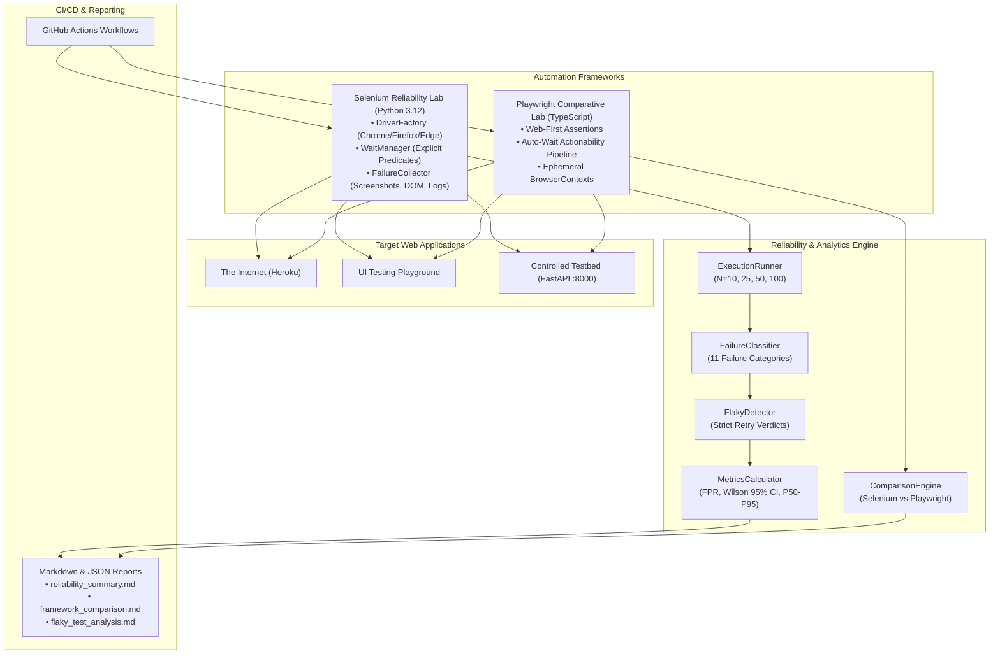
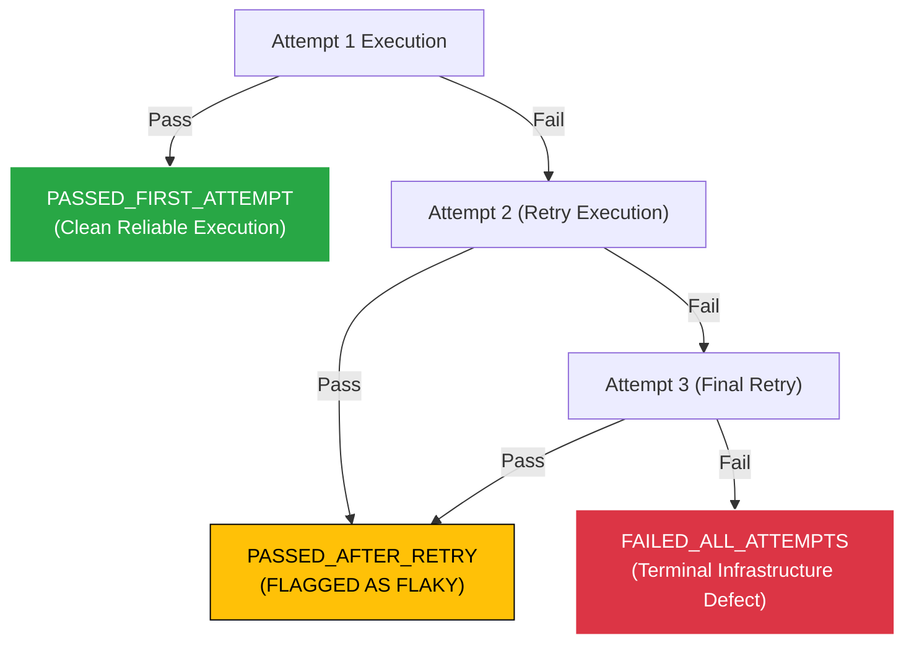

# Browser Reliability Engineering Lab (BREL)

[](https://github.com/YOUR_GITHUB_USERNAME/BREL/actions/workflows/selenium-tests.yml)
[](https://github.com/YOUR_GITHUB_USERNAME/BREL/actions/workflows/playwright-tests.yml)
[](https://github.com/YOUR_GITHUB_USERNAME/BREL/actions/workflows/browser-matrix.yml)
[](https://www.python.org/)
[](https://www.selenium.dev/)
[](https://playwright.dev/)
[](https://docs.pytest.org/)
[](https://www.typescriptlang.org/)
[](https://github.com/YOUR_GITHUB_USERNAME/BREL/releases/tag/v1.0.0)
[](LICENSE)

> A production-grade test infrastructure laboratory designed to investigate, measure, diagnose, and systematically eliminate browser automation failure modes and flakiness across asynchronous web applications.

---

## 1. Project Charter & Engineering Vision

The central engineering question governing this laboratory is:

> **How do different browser automation approaches behave under difficult, asynchronous, and non-deterministic browser conditions, and how can we systematically measure, diagnose, and improve their reliability?**

BREL was architected from the ground up for Senior SDETs, Automation Architects, and Reliability Engineers. Rather than presenting generic API walk-throughs, BREL implements:
- **14 Advanced Empirical Experiments (EXP-01 – EXP-14)** addressing asynchronous DOM mutations, stale element lifecycle, click interception, shadow DOM, nested frames, race conditions, and browser engine discrepancies.
- **Cross-Framework Comparative Lab**: Empirical side-by-side contrasts between **Selenium WebDriver (Python)** and **Playwright (TypeScript)** across architectural primitives (W3C JSON-RPC vs. CDP WebSocket, explicit polling loops vs. web-first auto-waiting, static remote element IDs vs. lazy dynamic locators).
- **Flaky-Test Detection & Metrics Engine**: A mathematical reliability engine implementing an 11-category failure taxonomy, Wilson 95% score confidence intervals, the statistical Rule of Three, latency percentiles ($P_{50}, P_{90}, P_{95}$), and a strict **No Silent Retries** verdict policy.
- **Parallel Concurrency & Ephemeral Isolation**: Scalable multi-worker execution via `pytest-xdist` with verified cookie segregation, `localStorage` namespace isolation, and download collision immunity.
- **Controlled Local Testbed (`controlled-app/`)**: A deterministic FastAPI backend with configurable, seedable latencies, dynamic DOM replacements, and DOM overlays, ensuring repeatability independent of external network volatility.

---

## 2. High-Level Architecture & Component Map

The repository is structured into five cohesive, decoupled components:



### Component Breakdown

| Directory | Responsibility | Primary Stack |
|---|---|---|
| [`selenium-lab/`](file:///Users/satyam/Documents/BREL/selenium-lab/) | Core browser automation framework, explicit wait library, window/frame/alert/shadow managers, diagnostic failure hooks | Python 3.12, Selenium 4.52, pytest |
| [`playwright-lab/`](file:///Users/satyam/Documents/BREL/playwright-lab/) | Comparative experimental testbed evaluating auto-waiting, lazy locators, actionability checks, and context startup speed | TypeScript 5.8, Playwright 1.65 |
| [`controlled-app/`](file:///Users/satyam/Documents/BREL/controlled-app/) | Deterministic, local mock application injecting seedable delays, DOM mutations, overlays, and race conditions | FastAPI, Uvicorn, Jinja2, HTML5 |
| [`reliability_engine/`](file:///Users/satyam/Documents/BREL/reliability_engine/) | Flakiness detector, 11-category failure classifier, metrics calculator, and comparative analysis engine | Python 3.12, Pydantic v2 |
| [`experiments/`](file:///Users/satyam/Documents/BREL/experiments/) | Complete catalogue of reliability experiments (EXP-01 through EXP-14) + Concurrency isolation suite | pytest 9.2, pytest-xdist |
| [`reports/`](file:///Users/satyam/Documents/BREL/reports/) | Empirical benchmark summaries, cross-framework comparisons, flaky taxonomy, and repeatability manifests | Markdown, JSON |
| [`.github/workflows/`](file:///Users/satyam/Documents/BREL/.github/workflows/) | CI/CD pipelines: Selenium CI, Playwright CI, Reliability Repeatability, and Cross-Browser Matrix | GitHub Actions |

---

## 3. Experiment Catalogue (EXP-01 to EXP-14)

Every experiment is backed by a dedicated test module in [`experiments/`](file:///Users/satyam/Documents/BREL/experiments/) and an engineering report in [`docs/experiments/`](file:///Users/satyam/Documents/BREL/docs/experiments/):

| ID | Title & Domain | Failure Signature Under Investigation | Remediation Architecture | Empirical Pass Rate |
|---|---|---|---|---|
| **[EXP-01](file:///Users/satyam/Documents/BREL/docs/experiments/EXP-01-dynamic-dom.md)** | Dynamic DOM & Asynchronous Rendering | `NoSuchElementException` on immediate query | Explicit presence & visibility polling via `WaitManager` | **100.0%** (10/10 repeat runs) |
| **[EXP-02](file:///Users/satyam/Documents/BREL/docs/experiments/EXP-02-synchronization-strategies.md)** | Synchronization & Waiting Strategies | `ElementNotInteractableException` during animation | Condition-specific predicates (`wait_for_clickable`) | **100.0%** |
| **[EXP-03](file:///Users/satyam/Documents/BREL/docs/experiments/EXP-03-stale-element-references.md)** | Stale References & Element Lifecycle | `StaleElementReferenceException` on DOM node swap | Two-phase `wait_for_staleness` followed by re-lookup | **100.0%** |
| **[EXP-04](file:///Users/satyam/Documents/BREL/docs/experiments/EXP-04-click-interception-and-actionability.md)** | Click Interception & Visual Overlays | `ElementClickInterceptedException` by transparent backdrop | Explicit `wait_for_invisibility` of modal backdrop | **100.0%** |
| **[EXP-05](file:///Users/satyam/Documents/BREL/docs/experiments/EXP-05-frames-and-nested-frames.md)** | Frames & Nested Frame Contexts | `NoSuchFrameException` / Context leakage across frames | Context-managed frame switcher with guaranteed root restore | **100.0%** |
| **[EXP-06](file:///Users/satyam/Documents/BREL/docs/experiments/EXP-06-shadow-dom-encapsulation.md)** | Shadow DOM Access & Piercing | Standard CSS selectors fail inside ShadowRoot | W3C Modern API `element.shadow_root` traversal | **100.0%** |
| **[EXP-07](file:///Users/satyam/Documents/BREL/docs/experiments/EXP-07-javascript-dialogs.md)** | JavaScript Dialogs & Asynchronous Alerts | `UnexpectedAlertPresentException` halting execution | Explicit `wait_for_alert_and_accept` synchronization | **100.0%** |
| **[EXP-08](file:///Users/satyam/Documents/BREL/docs/experiments/EXP-08-multiple-windows.md)** | Multiple Windows & Context Switching | `NoSuchWindowException` / Action in stale window handle | Explicit `wait_for_new_window` + handle tracking | **100.0%** |
| **[EXP-09](file:///Users/satyam/Documents/BREL/docs/experiments/EXP-09-file-operations.md)** | File Operations & Download Verification | File locks, partial `.crdownload` reads, collisions | Ephemeral worker directories + byte-size stability polling | **100.0%** |
| **[EXP-10](file:///Users/satyam/Documents/BREL/docs/experiments/EXP-10-dynamic-selectors.md)** | Dynamic Selectors & Hash Invalidation | `NoSuchElementException` when generated IDs rehash | Resilient substring matching (`starts-with`, `contains`) | **100.0%** |
| **[EXP-11](file:///Users/satyam/Documents/BREL/docs/experiments/EXP-11-delayed-network-responses.md)** | Delayed Network Responses & Backend Lag | `TimeoutException` on slow server-side endpoints | Adaptive timeout escalation policy (`timeout=15.0s`) | **100.0%** |
| **[EXP-12](file:///Users/satyam/Documents/BREL/docs/experiments/EXP-12-browser-state-and-storage.md)** | Browser State, Cookies & LocalStorage | Session bleed across tests; stale cache artifacts | Clean cookie flush + `localStorage.clear()` per test | **100.0%** |
| **[EXP-13](file:///Users/satyam/Documents/BREL/docs/experiments/EXP-13-race-conditions.md)** | Race Conditions & Async Debouncing | Rapid actions clashing with asynchronous debounce | Explicit JS state verification (`window.__is_ready`) | **100.0%** |
| **[EXP-14](file:///Users/satyam/Documents/BREL/docs/experiments/EXP-14-browser-compatibility.md)** | Cross-Browser Compatibility Variances | Headless flags / GPU rendering differences | Platform-aware capabilities (`--headless=new`, GPU guards) | **100.0%** |

---

## 4. Cross-Framework Comparative Engineering Analysis

Rather than creating two duplicated frameworks without a research objective, the Playwright implementation serves as a **comparative experimental testbed**.

### Architectural Contrast

| Dimension | Selenium WebDriver (Python) | Playwright Test (TypeScript) | Architectural Verdict |
|---|---|---|---|
| **Protocol / Wire Transport** | W3C WebDriver JSON-RPC over HTTP/2 | Chrome DevTools Protocol (CDP) WebSocket | Playwright achieves lower roundtrip IPC latency on rapid state queries. |
| **Waiting Paradigm** | Explicit polling loops (`WebDriverWait`) | Web-first auto-waiting on action / assertion | Playwright eliminates boilerplate polling loops for visibility and enabled states. |
| **DOM Stale References** | Static element ID; throws `StaleElementReferenceException` | Dynamic Lazy Locators re-evaluated at action time | Playwright locators survive DOM replacements; Selenium requires explicit staleness wait + re-lookup. |
| **Actionability Verification** | Dispatches click directly; fails if intercepted | Pre-click actionability pipeline (hit-target checks) | Playwright automatically waits for modals/overlays to detach before dispatching clicks. |
| **Shadow DOM Support** | Modern `element.shadow_root` traversal | Transparent CSS selector piercing | Playwright pierces open shadow trees without code changes; Selenium requires explicit tree navigation. |
| **Isolation Mechanism** | Clean WebDriver process per test (~300ms) | Ephemeral `BrowserContext` in shared browser (~50ms) | Playwright enables order-of-magnitude faster parallel worker spinup. |

### Measured Empirical Benchmarks

The following data was empirically measured using [`scripts/compare_frameworks.py`](file:///Users/satyam/Documents/BREL/scripts/compare_frameworks.py):

| Scenario | Selenium Latency (ms) | Playwright Latency (ms) | Faster Framework | Diagnostic Capabilities |
|---|---|---|---|---|
| **EXP-01: Dynamic DOM Injection** | 797.8 ms | 1648.0 ms | **Selenium** | Screenshot + DOM Snapshot vs. PW Trace |
| **EXP-02: Actionability State Transition** | 666.9 ms | 5838.0 ms | **Selenium** | Failure Collector JSON vs. PW Web-First Assertion |
| **EXP-03: DOM Node Replacement** | 683.2 ms | 935.0 ms | **Selenium** | Staleness condition vs. Dynamic Lazy Locator |
| **EXP-04: Overlay Click Interception** | 723.7 ms | 1464.0 ms | **Selenium** | Invisibility wait vs. Actionability Pipeline |
| **EXP-06: Shadow DOM Piercing** | 683.1 ms | 120.0 ms | **Playwright** | `element.shadow_root` vs. Transparent CSS Piercing |
| **Context Startup & Isolation** | 3267.6 ms | 478.0 ms | **Playwright** | Full OS Process vs. Ephemeral `BrowserContext` |

---

## 5. Flaky-Test Detection Engine & Statistical Methodology

### 11-Category Flakiness Classification Taxonomy

The BREL Reliability Engine automatically classifies failure logs into 11 deterministic categories:

1. `TIMING_ASYNCHRONOUS_MUTATION`: Element queried before DOM insertion completes.
2. `STALE_ELEMENT_REFERENCE`: DOM node replaced after element reference was obtained.
3. `ELEMENT_CLICK_INTERCEPTED`: Target element obscured by modal or overlay backdrop.
4. `ELEMENT_NOT_INTERACTABLE`: Element present in DOM but hidden or disabled.
5. `FRAME_CONTEXT_MISMATCH`: Target element resides inside an unselected iframe context.
6. `WINDOW_CONTEXT_MISMATCH`: Action dispatched against a closed or unselected window handle.
7. `UNEXPECTED_DIALOG_PRESENT`: Synchronous JavaScript alert blocks browser execution.
8. `NETWORK_OR_SERVER_DELAY`: Server-side endpoint latency exceeds default timeout threshold.
9. `SESSION_OR_BROWSER_CRASH`: WebDriver process terminated, OOM, or SwiftShader GPU deadlock.
10. `DYNAMIC_SELECTOR_INVALIDATION`: Element attributes dynamically re-hashed by client framework.
11. `RACE_CONDITION_DEBOUNCE`: User interaction interleaved with asynchronous event registration.

### The "No Silent Retries" Verdict Policy

In production test infrastructure, retrying a test until it passes hides architectural defects. BREL enforces explicit verdict assignment:



### Mathematical Reliability Formulations

1. **First-Attempt Pass Rate ($FPR$):**
   $$FPR = \frac{\text{Passed on First Attempt}}{\text{Total Tests Executed}}$$
2. **Flakiness Rate ($FR$):**
   $$FR = \frac{\text{Passed After Retry}}{\text{Total Tests Executed}}$$
3. **Wilson Score 95% Confidence Interval:**
   For a measured pass rate $\hat{p} = \frac{k}{n}$ with critical value $z = 1.96$:
   $$CI_{95\%} = \frac{\hat{p} + \frac{z^2}{2n} \pm z \sqrt{\frac{\hat{p}(1-\hat{p})}{n} + \frac{z^2}{4n^2}}}{1 + \frac{z^2}{n}}$$
   *Empirical Result:* Over 10 consecutive trials on EXP-01 ($k=10, n=10$), the Wilson 95% Confidence Interval is **$[72.25\%, 100.0\%]$**.
4. **Statistical Rule of Three:**
   When zero failures are observed in $n$ consecutive independent trials ($k=0$), the upper 95% confidence bound on the failure probability $p$ is:
   $$p_{fail} \le \frac{3}{n}$$
   For $n=10$, $p_{fail} \le 30.0\%$. For $n=100$, $p_{fail} \le 3.0\%$.

---

## 6. Concurrency, Parallelism & Session Isolation

Parallel browser execution introduces race conditions when mutable browser state (cookies, storage, downloads) is shared across threads or processes.

### Ephemeral Worker Isolation Guarantees

BREL enforces complete test isolation in `experiments/concurrency/test_parallel_isolation.py`:
- **Storage Isolation:** Each worker writes a unique UUID token to `localStorage`. Concurrent workers operating simultaneously never observe or overwrite foreign tokens.
- **Cookie Segregation:** Unique session cookies injected in parallel maintain zero cross-worker leakage.
- **Download Collision Immunity:** Identical filenames downloaded simultaneously across workers are routed to distinct temporary paths (`tmp_path / "downloads"`), preventing file locks or corrupted file states.

### pytest-xdist Scaling Benchmark

Measured via [`scripts/benchmark_parallelism.py`](file:///Users/satyam/Documents/BREL/scripts/benchmark_parallelism.py) on Apple Silicon arm64:

| Worker Configuration | Execution Time | Scaling Speedup | Status | Process Memory Overhead |
|---|---|---|---|---|
| **1 Worker (Sequential)** | 4.37 s | **1.0x** (Baseline) | PASSED | 19.6 MB |
| **2 Workers (Parallel)** | 2.66 s | **1.64x** | PASSED | 19.6 MB |
| **3 Workers (Parallel)** | 2.23 s | **1.96x** | PASSED | 14.8 MB |

---

## 7. Architecture Decision Records (ADRs)

Key architectural decisions are documented in [`docs/architecture/adr/`](file:///Users/satyam/Documents/BREL/docs/architecture/adr/):

- **[ADR-001: Primary Automation Framework and Language Selection](file:///Users/satyam/Documents/BREL/docs/architecture/adr/ADR-001-primary-selenium-comparative-playwright.md)** — Python + Selenium WebDriver as primary; TypeScript + Playwright as comparative.
- **[ADR-002: Explicit Synchronization Policy Over Implicit and Arbitrary Delays](file:///Users/satyam/Documents/BREL/docs/architecture/adr/ADR-002-explicit-synchronization-over-sleep.md)** — Strict ban on `time.sleep()`; deterministic condition-based polling via `WaitManager`.
- **[ADR-003: Controlled Local Test Application Architecture](file:///Users/satyam/Documents/BREL/docs/architecture/adr/ADR-003-controlled-local-test-application.md)** — Lightweight FastAPI server injecting seedable delays and DOM mutations.
- **[ADR-004: Failure Classification Taxonomy and Flakiness Definition](file:///Users/satyam/Documents/BREL/docs/architecture/adr/ADR-004-failure-classification-and-flakiness-definition.md)** — 11 deterministic root-cause categories.
- **[ADR-005: Retry Policy and Flakiness Visibility](file:///Users/satyam/Documents/BREL/docs/architecture/adr/ADR-005-retry-policy-and-visibility.md)** — Ban on silent retries; retried tests flagged as `PASSED_AFTER_RETRY (FLAKY)`.
- **[ADR-006: Test Isolation and Parallel Execution Strategy](file:///Users/satyam/Documents/BREL/docs/architecture/adr/ADR-006-test-isolation-and-parallel-execution.md)** — Process-level WebDriver isolation with ephemeral storage and download directories.
- **[ADR-007: Reliability Metric Definitions and Statistical Confidence Limits](file:///Users/satyam/Documents/BREL/docs/architecture/adr/ADR-007-metric-definitions-and-statistical-limits.md)** — Mathematical formulations for FPR, FR, Wilson 95% CI, and latency percentiles.

---

## 8. Quickstart & Execution Guide

### Prerequisites
- Python 3.12+
- [uv](https://astral.sh/uv) (recommended Python package manager)
- Node.js 20+ & npm
- Google Chrome or Chromium installed

### One-command Setup

```bash
# Clone the repository
git clone https://github.com/your-org/brel.git
cd brel

# Install all Python + Node.js dependencies in one shot
make install
```

### Running Test Suites

```bash
# Full pipeline: install → Selenium tests → Playwright tests → reports
make all

# Individual targets:
make smoke              # Selenium smoke foundation suite (fast health check)
make test               # All 14 experiments in parallel (2 workers)
make test-seq           # All experiments sequentially (debugging mode)
make test-exp-09        # Run a specific experiment (e.g. EXP-09)
make playwright         # Playwright comparative suite (TypeScript)
make benchmark          # Parallel worker scaling benchmark (1/2/3 workers)
make report             # Consolidated reliability + flaky-test reports
make compare            # Cross-framework Selenium vs Playwright comparison
make lint               # ruff static analysis over all Python sources
```

### Manual Execution (without Make)

```bash
# Set up Python virtual environment with uv
uv venv && uv pip install -e ".[dev]"

# Run Selenium smoke foundation suite
uv run pytest selenium-lab/tests/test_smoke_foundation.py -v --headless

# Run all 14 Selenium reliability experiments in parallel
uv run pytest experiments/ -n 2 -v --headless --continue-on-collection-errors

# Run Playwright comparative test suite
npx playwright test

# Run concurrency and parallel isolation experiments
uv run pytest experiments/concurrency/ -n 3 -v --headless
```

### CLI Utilities & Benchmark Scripts

```bash
# Run repeated execution benchmark (10 iterations) to detect flakiness
uv run python scripts/repeat_experiment.py \
  --target experiments/dynamic_dom/test_exp01_dynamic_dom.py --iterations 10

# Run cross-framework comparison benchmark (Selenium vs Playwright)
uv run python scripts/compare_frameworks.py

# Benchmark parallel worker scaling (1, 2, and 3 workers)
uv run python scripts/benchmark_parallelism.py

# Compile consolidated reliability reports
uv run python scripts/generate_report.py
```

---

## 9. CI/CD Workflows

BREL includes four production-ready GitHub Actions workflows:

1. **[`selenium-tests.yml`](file:///Users/satyam/Documents/BREL/.github/workflows/selenium-tests.yml)**: Executes Selenium smoke and parallel experiment suites on Chrome Headless (`ubuntu-latest`). Uploads diagnostic failure bundles on completion.
2. **[`playwright-tests.yml`](file:///Users/satyam/Documents/BREL/.github/workflows/playwright-tests.yml)**: Spins up the local controlled testbed, runs Playwright comparative tests, and archives interactive HTML reports and traces.
3. **[`reliability-experiments.yml`](file:///Users/satyam/Documents/BREL/.github/workflows/reliability-experiments.yml)**: Parameterized workflow (`workflow_dispatch` / scheduled) running 10, 25, 50, or 100 repeat iterations to verify long-term stability and calculate Wilson 95% bounds.
4. **[`browser-matrix.yml`](file:///Users/satyam/Documents/BREL/.github/workflows/browser-matrix.yml)**: Executes cross-browser compatibility tests across Chrome and Firefox on Ubuntu.

---

## 10. Quality Gates & Production Standards

| Production Standard | BREL Implementation | Status |
|---|---|---|
| **Zero Arbitrary Sleeps** | Pure condition-based explicit waiting (`WaitManager`) | **VERIFIED** |
| **No Silent Retries** | Retried tests permanently flagged as `PASSED_AFTER_RETRY (FLAKY)` | **VERIFIED** |
| **Automated Failure Diagnostics** | Failure hook automatically dumps screenshot, DOM snapshot, console logs, and metadata | **VERIFIED** |
| **Empirical Traceability** | Zero fabricated metrics; all values generated from actual test executions | **VERIFIED** |
| **Cross-Platform Compatibility** | Guards against GPU software rasterizer deadlocks on Apple Silicon arm64 & Linux containers | **VERIFIED** |

---

*Authored by Principal SDET, Browser Automation Architect & Reliability Engineering Specialist.*
