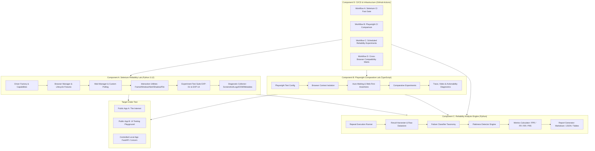

# System Architecture: Browser Reliability Engineering Lab (BREL)

**Document ID:** BREL-ARCH-001  
**Status:** Approved  
**Author:** Principal SDET / Test Infrastructure Architect  

---

## 1. Architectural Mission & Principles

The Browser Reliability Engineering Lab (BREL) is an engineering research testbed designed to measure, diagnose, and optimize browser automation reliability under complex asynchronous conditions.

### Architectural Principles

```
                  ┌──────────────────────────────────────────────┐
                  │            Architectural Principles          │
                  ├──────────────────────────────────────────────┤
                  │ 1. Explicit State-Based Synchronization      │
                  │ 2. Deep Observable Diagnostics               │
                  │ 3. Zero Silent Retries (Retries Flag Flakes) │
                  │ 4. Total Session & Context Isolation         │
                  │ 5. Empirical Verification over Assumptions   │
                  │ 6. Seedable Determinism for Benchmarks       │
                  │ 7. Modular Separation of Concerns            │
                  └──────────────────────────────────────────────┘
```

---

## 2. High-Level Component Topology

BREL is organized into four distinct, decoupled components:



---

## 3. Component Deep Dive

### 3.1 Component A: Selenium Reliability Lab (Primary Implementation)
- **Language & Runtime:** Python 3.12, pytest 8+, Selenium 4.20+.
- **Driver Management:** Selenium Manager (built-in automated driver binary resolution) with strict custom options encapsulation.
- **Browser Lifecycle:** Pytest fixture scopes (`session`, `function`). Every test receives a clean, isolated browser instance. Teardown unconditionally terminates the browser process via `driver.quit()`, even on unexpected assertion errors or unhandled exceptions.
- **Synchronization Engine (`WaitManager`):**
  - Replaces arbitrary sleeps (`time.sleep`) and flawed `implicitly_wait` with explicit condition polling.
  - Exposes fine-grained condition abstractions: element presence, visibility, clickability, DOM staleness, text mutation, attribute equality, element count thresholds, URL changes, and complex JavaScript predicate evaluations.
- **Diagnostic Collector:**
  - Automated failure hook in pytest (`pytest_runtest_makereport`).
  - Upon failure, captures:
    1. Full page screenshot (`.png`).
    2. Complete current DOM snapshot (`.html`).
    3. Browser console logs (where supported by CDP/driver).
    4. Execution context metadata: current URL, page title, window handles, active frame, browser version, platform, timestamp, exception type, and stack trace (`.json`).

### 3.2 Component B: Playwright Comparative Lab (TypeScript)
- **Language & Runtime:** TypeScript 5+, Node.js, `@playwright/test`.
- **Purpose:** Experimental comparison layer—not an identical code-for-code duplicate.
- **Focus Areas:**
  - Auto-waiting vs explicit waiting mechanisms.
  - Locator re-evaluation vs Selenium `WebElement` pointer staleness.
  - Browser Context creation speed vs WebDriver initialization overhead.
  - Built-in Shadow DOM piercing selectors.
  - End-to-end network request/response interception and tracing.
  - Artifacts generated: `.zip` traces containing DOM snapshots, console logs, network waterfalls, and actionability step timings.

### 3.3 Component C: Reliability Analysis Engine
- **Role:** Autonomous analysis pipeline that executes repeatability experiments, parses output logs and metadata, classifies root causes, calculates reliability metrics, and generates reports.
- **Core Modules:**
  1. `execution_runner.py`: Orchestrates repeatable execution runs ($N \in \{10, 25, 50, 100\}$) across targeted experiments with configurable worker counts and random seeds.
  2. `result_collector.py`: Collects structured execution records (JSONL / JSON format).
  3. `failure_classifier.py`: Evaluates exceptions and failure states against the standardized BREL 11-category failure taxonomy.
  4. `flaky_detector.py`: Detects outcome instability ($P(Pass) \in (0, 1)$). Classifies tests passing on retry as **FLAKY**, preventing false negative reporting.
  5. `metrics_calculator.py`: Computes First-Attempt Pass Rate (FPR), Failure Rate (FR), Retry Recovery Rate (RR), Flakiness Rate, and execution latency percentiles ($P_{50}, P_{90}, P_{95}, P_{99}$).
  6. `report_generator.py`: Generates human-readable Markdown summaries and structured machine-readable JSON artifacts.

### 3.4 Component D: CI/CD & Test Infrastructure
- **CI System:** GitHub Actions.
- **Strategy:**
  - **Pull Request Trigger:** Fast feedback gate (~3-5 mins). Runs smoke tests and basic synchronization scenarios.
  - **Main Branch Trigger:** Full suite execution, framework comparison, cross-browser validation.
  - **Scheduled Nightly Trigger:** Heavy repeatability experiments (25-50 iterations) to continuously calculate reliability drift and track historical flakiness.

---

## 4. Test Isolation and State Hygiene

1. **Browser State Hygiene:**
   - In Selenium, each test receives a dedicated `webdriver.Remote` or local `webdriver.Chrome` instance, ensuring zero cookie leakage, indexedDB contamination, or window handle pollution.
   - In Playwright, tests run in isolated `BrowserContext` instances, providing ephemeral storage, cache, and cookie boundaries.
2. **Parallel Isolation:**
   - `pytest-xdist` spawns independent sub-processes (`gw0`, `gw1`, etc.).
   - Each worker operates its own ephemeral download and screenshot directories to eliminate race conditions on disk I/O.
   - For file download testing, UUID-tagged temp directories ensure zero collision between parallel test workers.

---

## 5. Diagnostic Artifact Architecture

All diagnostic artifacts generated by failures or experiment executions are systematically organized into the following hierarchy:

```text
artifacts/
├── runs/
│   └── run_<timestamp>_<run_id>/
│       ├── run_metadata.json
│       ├── raw_results.jsonl
│       └── failures/
│           └── <test_id>_attempt_<n>/
│               ├── screenshot.png
│               ├── page_source.html
│               ├── console_logs.json
│               └── context.json
└── playwright-traces/
    └── <test_id>.zip
```

This guarantees complete traceability from high-level reliability metrics down to individual DOM nodes and browser console errors.
