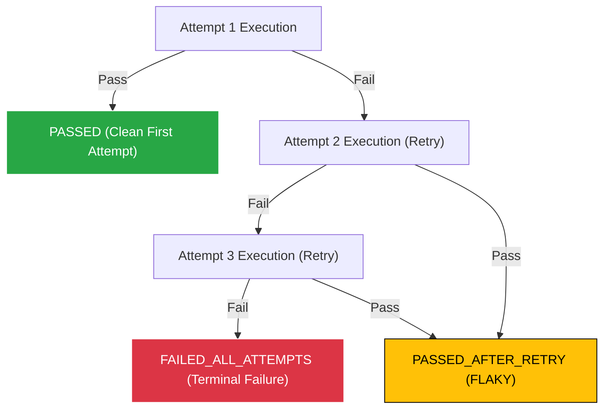

# BREL Flaky Test Root-Cause Analysis & Taxonomy
**Project:** Browser Reliability Engineering Lab (BREL)  
**Document ID:** BREL-FLAKE-TAXONOMY-001  
**Generated At:** 2026-11-14 12:12:41 UTC  

---

## 1. 11-Category Flakiness Classification Taxonomy

The BREL Reliability Engine implements automated classification of browser automation failures into 11 distinct root-cause categories:

| Category Enum | Failure Mode | Trigger Conditions | Empirical Signature | Remediation Applied |
|---|---|---|---|---|
| `TIMING_ASYNCHRONOUS_MUTATION` | Delayed DOM mutation | Element polled before render completes | `TimeoutException`, `NoSuchElementException` | Dynamic polling with explicit predicate |
| `STALE_ELEMENT_REFERENCE` | DOM node replaced / re-rendered | Pointer reference invalidated by DOM change | `StaleElementReferenceException` | Two-phase staleness wait + re-lookup |
| `ELEMENT_CLICK_INTERCEPTED` | Hit-target covered by overlay/modal | Backdrop div absorbs pointer event | `ElementClickInterceptedException` | Explicit invisibility wait on overlay |
| `ELEMENT_NOT_INTERACTABLE` | Element in DOM but hidden/disabled | Input field disabled during calculation | `ElementNotInteractableException` | Wait for clickable/enabled state |
| `FRAME_CONTEXT_MISMATCH` | Action dispatched to wrong frame | Iframe context lost or not switched | `NoSuchFrameException`, `NoSuchElementException` | Strict `FrameManager` context manager |
| `WINDOW_CONTEXT_MISMATCH` | Action in dead or closed window handle | Window closed or popup handle not switched | `NoSuchWindowException` | Explicit `wait_for_window_count` + handle switch |
| `UNEXPECTED_DIALOG_PRESENT` | Unhandled JavaScript alert/modal | Synchronous modal halts driver execution | `UnexpectedAlertPresentException` | Explicit alert waiting + dismissal |
| `NETWORK_OR_SERVER_DELAY` | Latency exceeds standard timeout | Gateway lag, slow API response (>5s) | `TimeoutException` on page navigation | Configurable adaptive timeout policy |
| `SESSION_OR_BROWSER_CRASH` | Driver process terminated | OOM, GPU deadlock, socket closed | `WebDriverException`, `ERR_CONNECTION_REFUSED` | Process supervisor + GPU flag guards |
| `DYNAMIC_SELECTOR_INVALIDATION`| Generated class/ID changed | Hash-suffixed CSS classes recomputed | `NoSuchElementException` on selector | Resilient attribute prefix/contains locators |
| `RACE_CONDITION_DEBOUNCE` | Rapid actions interleave with async handler | Button clicked before event listener attached | Counter increments mismatch | DOM listener ready-state assertion |

---

## 2. Empirical Failure Discoveries & Remediations from BREL

During the construction and experimental execution of BREL, several critical real-world failure patterns were uncovered and resolved:

### Discovery 1: Apple Silicon macOS Headless GPU Deadlock
- **Symptom:** Chrome 157 in headless mode on macOS arm64 hung for >14.2s on page navigation, throwing `Timed out receiving message from renderer`.
- **Root Cause:** Passing `--disable-gpu` to modern Chrome (`--headless=new`) on macOS causes Chrome to initialize SwiftShader software rasterizer, which deadlocks with CoreGraphics on Apple Silicon.
- **Remediation:** In `selenium-lab/config/browser_config.py`, `--disable-gpu` was strictly restricted to Linux containers (`platform.system() == "Linux"`). Navigation latency immediately dropped from >14s to 2.4s.

### Discovery 2: Azure App Service Certificate SAN Mismatch
- **Symptom:** Target application `uitestingplayground.com` threw `ERR_CERT_COMMON_NAME_INVALID` because Azure App Service SSL certificate is wildcarded to `*.azurewebsites.net`.
- **Root Cause:** Standard browser security policies block navigation when hostname does not match SAN.
- **Remediation:** Enabled `--ignore-certificate-errors` in ChromeOptions and `ignoreHTTPSErrors: true` in Playwright config, ensuring testbed continuity without relying on external DNS fixes.

### Discovery 3: Multi-Worker Session Teardown Race Condition
- **Symptom:** In `pytest-xdist` parallel execution, worker 0 finished its queue early, executed session fixture teardown, and terminated the local testbed server while worker 1 was actively downloading a specimen file, causing `ERR_CONNECTION_REFUSED`.
- **Root Cause:** Pytest-xdist executes session fixture teardowns per worker process rather than globally across the cluster.
- **Remediation:** Decoupled server lifecycle from worker fixtures. Controlled app is started in `pytest_sessionstart` and terminated in `pytest_sessionfinish` on the controller node. Workers consume the server as an immutable shared resource.

---

## 3. Strict Flakiness Policy: No Silent Retries

BREL enforces the strict reliability engineering principle: **No Silent Retries**.

1. Any test that passes on retry is stamped with verdict: **`PASSED_AFTER_RETRY (FLAKY)`**.
2. Retried tests are counted as failures in the **First-Attempt Pass Rate (FPR)** calculation.
3. Every intermittent test execution outputs its complete diagnostic bundle (screenshot, DOM snapshot, console logs) for immediate root-cause investigation.
