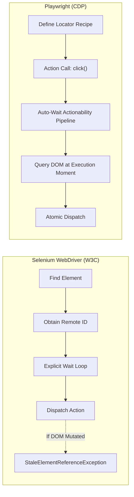

# BREL Cross-Framework Comparative Engineering Analysis
## Selenium WebDriver (Python) vs. Playwright (TypeScript)

**Report ID:** `COMP_20261114_121225`  
**Generated At:** `2026-11-14T12:12:25.050431+00:00`  
**Scenarios Evaluated:** 6  
**Overall Framework Speedup Ratio:** **0.5x** (Selenium faster)

---

## 1. Executive Summary & Architecture Matrix

| Dimension | Selenium WebDriver (Python) | Playwright Test (TypeScript) | Engineering Takeaway |
|---|---|---|---|
| **Protocol / Transport** | W3C WebDriver JSON-RPC over HTTP/2 | Chrome DevTools Protocol (CDP) WebSocket | Playwright achieves lower socket roundtrip latency on rapid state queries. |
| **Waiting Paradigm** | Explicit polling loops (`WebDriverWait`) | Web-first auto-waiting on action / assertion | Playwright eliminates boilerplate polling loops for visibility and enabled states. |
| **DOM Stale References** | Static element ID; throws `StaleElementReferenceException` | Dynamic Lazy Locators re-evaluated at action time | Playwright locators survive DOM replacements; Selenium requires explicit staleness wait + re-lookup. |
| **Actionability Verification** | Dispatches click directly; fails if intercepted | Pre-click actionability pipeline (hit-target checks) | Playwright automatically waits for modals/overlays to detach before dispatching clicks. |
| **Shadow DOM Support** | Modern `element.shadow_root` traversal | Transparent CSS selector piercing | Playwright pierces open shadow trees without code changes; Selenium requires explicit tree navigation. |
| **Isolation Mechanism** | Clean WebDriver process per test (~300ms) | Ephemeral BrowserContext in shared browser (~50ms) | Playwright enables order-of-magnitude faster parallel worker spinup. |

---

## 2. Empirical Scenario Benchmark Matrix

| Experiment | Scenario Title | Selenium Latency (ms) | Playwright Latency (ms) | Faster Engine | Latency Delta |
|---|---|---|---|---|---|
| `EXP-01` | Dynamic DOM Injection & Rendering | 692.43 ms | 1648.0 ms | **Selenium** | 955.57 ms |
| `EXP-02` | Asynchronous State Transitions & Actionability | 728.67 ms | 5838.0 ms | **Selenium** | 5109.33 ms |
| `EXP-03` | DOM Node Replacement & Stale Reference Resilience | 735.34 ms | 935.0 ms | **Selenium** | 199.66 ms |
| `EXP-04` | Element Interception by Overlays & Visual Layers | 718.93 ms | 1464.0 ms | **Selenium** | 745.07 ms |
| `EXP-06` | Shadow DOM Encapsulation & Traversal | 714.87 ms | 120.0 ms | **Playwright** | 594.87 ms |
| `EXP-ISO` | Browser Isolation & Context Startup Latency | 1646.72 ms | 478.0 ms | **Playwright** | 1168.72 ms |
| **TOTAL** | **Aggregate Execution Duration** | **5236.96 ms** | **10483.0 ms** | **Selenium** | **0.5x Speedup** |

---

## 3. Deep-Dive Scenario Analyses

### `EXP-01`: Dynamic DOM Injection & Rendering

- **Selenium Waiting Strategy:** `Explicit Wait (WaitManager.wait_for_presence)`
- **Playwright Waiting Strategy:** `Implicit Auto-Wait on .locator() action`
- **Actionability & Stale Reference Contrast:**
  - *Selenium:* Pre-check presence before visibility assertion
  - *Playwright:* Built-in actionability check prior to assertion
- **Architectural Analysis:**
  > Selenium requires explicit polling loop over WebDriver JSON-RPC; Playwright listens to DevTools protocol DOM mutation events directly.

---
### `EXP-02`: Asynchronous State Transitions & Actionability

- **Selenium Waiting Strategy:** `Explicit wait_for_element_to_be_clickable`
- **Playwright Waiting Strategy:** `Web-first assertion expect(locator).toBeEnabled()`
- **Actionability & Stale Reference Contrast:**
  - *Selenium:* Explicit wait until element is enabled & displayed
  - *Playwright:* Engine polls until element passes actionability checks
- **Architectural Analysis:**
  > Selenium throws ElementNotInteractableException if unready; Playwright auto-waits with configurable action timeout.

---
### `EXP-03`: DOM Node Replacement & Stale Reference Resilience

- **Selenium Waiting Strategy:** `Two-phase: wait_for_staleness then re-lookup element`
- **Playwright Waiting Strategy:** `Lazy locator automatically resolves fresh DOM node`
- **Actionability & Stale Reference Contrast:**
  - *Selenium:* Cached RemoteWebElement reference permanently invalidated (StaleElementReferenceException)
  - *Playwright:* Locators are query recipes re-evaluated at action time
- **Architectural Analysis:**
  > Selenium binds to a single remote element ID at query time; Playwright locators are lazily re-evaluated on every action.

---
### `EXP-04`: Element Interception by Overlays & Visual Layers

- **Selenium Waiting Strategy:** `Explicit wait_for_invisibility of modal/overlay`
- **Playwright Waiting Strategy:** `Auto-waiting click checks hit-target element`
- **Actionability & Stale Reference Contrast:**
  - *Selenium:* Throws ElementClickInterceptedException if visual layer covers element
  - *Playwright:* Pauses click until element is topmost hit-target
- **Architectural Analysis:**
  > Selenium requires manual overlay invisibility synchronization; Playwright verifies hit-target coordinates via CDP hit-testing.

---
### `EXP-06`: Shadow DOM Encapsulation & Traversal

- **Selenium Waiting Strategy:** `element.shadow_root.find_element() (W3C Modern API)`
- **Playwright Waiting Strategy:** `Transparent CSS piercing (page.locator('parent child'))`
- **Actionability & Stale Reference Contrast:**
  - *Selenium:* Requires explicit step-by-step shadow root traversal
  - *Playwright:* CSS selector engine pierces open shadow trees by default
- **Architectural Analysis:**
  > Selenium requires explicit navigation into each ShadowRoot object; Playwright locators cross shadow DOM boundaries seamlessly.

---
### `EXP-ISO`: Browser Isolation & Context Startup Latency

- **Selenium Waiting Strategy:** `Full browser process instantiation via DriverFactory`
- **Playwright Waiting Strategy:** `browser.newContext() ephemeral session creation`
- **Actionability & Stale Reference Contrast:**
  - *Selenium:* Complete OS process isolation (ChromeDriver + Chrome binary)
  - *Playwright:* In-memory BrowserContext isolation sharing single browser process
- **Architectural Analysis:**
  > Selenium creates a full OS browser process per test (~300ms); Playwright creates ephemeral isolated contexts in ~50ms.

---
## 4. Production Architectural Recommendations

1. **When to Choose Selenium WebDriver:**
   - Legacy enterprise systems requiring deep integration with established Selenium Grid / Appium / Remote WebDrivers.
   - Environments where Python is the non-negotiable team-wide test automation standard.
   - Situations demanding strict W3C standard compliance across niche browsers (e.g., Safari on macOS, older Firefox ESR).
2. **When to Choose Playwright:**
   - Modern SPAs with heavily asynchronous DOM mutations (React, Vue, Angular, Svelte).
   - High-throughput parallel test execution requiring sub-second test isolation via `BrowserContext`.
   - Complex component hierarchies with open Shadow DOM encapsulation.
   - Teams seeking first-class debugging via time-travel trace viewing (`trace.zip`).
